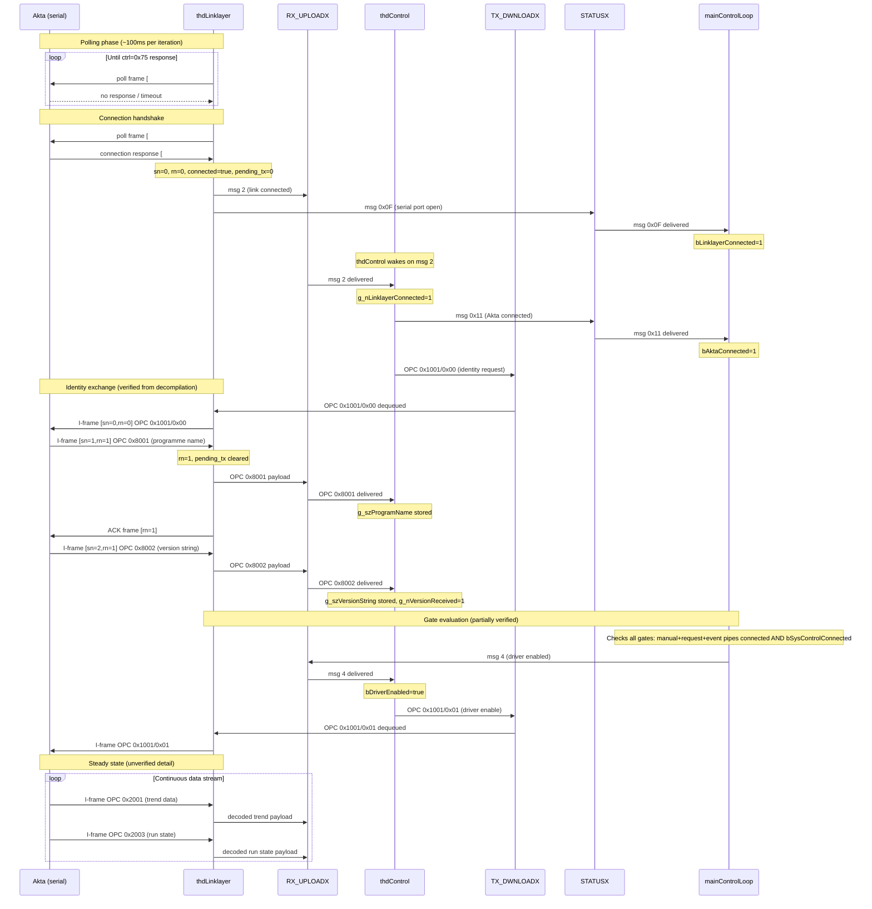

# AKTA Prime UNICORN Stack -- Decompilation Reference

Files analysed: `p232_drv.exe`, `Orqoci.dll`, `Comiface.dll`, `Oci.exe`,
`AInstrInfo.dll`, `Caktacal.dll`, `Csyscon.exe`

---

## p232_drv.exe

### Architecture overview

`p232_drv.exe` is a multi-threaded Windows process that bridges the RS-232
serial connection to the Akta instrument and the named-pipe/mailslot IPC
layer used by `Oci.exe` and the UNICORN/PrimeView client. All inter-thread
communication passes through four Windows mailslots created by
`mainControlLoop` at startup.

#### Mailslot roles

| Mailslot | Owner (server) | Writers | Readers | Purpose |
|---|---|---|---|---|
| `STATUSX` | `mainControlLoop` | All worker threads | `mainControlLoop` | Lifecycle event codes from threads upward |
| `TX_DWNLOADX` | `mainControlLoop` | `thdControl`, `pocManualPipeHandler` | `thdLinklayer` | Outbound OPC messages queued for serial TX |
| `RX_UPLOADX` | `mainControlLoop` | `thdLinklayer`, `mainControlLoop` | `thdControl` | Decoded Akta frames and link state inward |
| `ONLINEX` | `mainControlLoop` | `thdEvent`, `mainControlLoop` | `thdEvent` (→ LONLINE pipe) | Processed instrument data to client |

The mailslot name suffix `X` is the ASCII digit of the system index
(`g_bSystemIndex + 0x31`), allowing multiple Akta instances to run
simultaneously with separate mailslot sets.

#### STATUSX message codes

| Code | Meaning | Sender |
|---|---|---|
| `0x0f` | Serial port opened | `thdLinklayer` |
| `0x10` | Serial port closed/error | `thdLinklayer` |
| `0x11` | Akta instrument connected (ctrl=0x75 received) | `thdControl` |
| `0x12` | Akta instrument disconnected | `thdControl` |
| `0x13` | System control client connected | `pocRequestPipeHandler` |
| `0x14` | System control client disconnected | `pocRequestPipeHandler` |
| `3` | Manual pipe connected | `thdManual` |
| `4` | Manual pipe error/disconnect | `thdManual` |
| `7` | Event pipe connected | `thdEvent` |
| `8` | Event pipe error/disconnect | `thdEvent` |
| `0xb` | Request pipe connected | `thdRequest` |
| `0xc` | Request pipe error/disconnect | `thdRequest` |
| `100` | Shutdown signal | `pocRequestPipeHandler` |

---

### Connection and handshake protocol

The following sequence diagram covers the complete connection sequence from
initial serial polling through to the driver-enabled steady state. Sections
marked "partially verified" or "unverified" reflect the limits of static
analysis completed to date.



#### Open questions / unresolved

- Whether `0x8001` and `0x8002` arrive as separate I-frames or are combined
  in a single frame.
- The exact byte content of the `0x75` connection response beyond the ctrl
  byte.
- pH (`0x2001` CH 2) scale factor — no pH electrode in test system.
- Pressure (`0x2001` CH 5) physical units (MPa, bar, or other).
- %B (`0x2001` CH 3) maximum raw value and whether it can exceed 1000
  (10-bit field → max 1023 raw → 102.3% if ÷10).
- Initial valve and instrument state: embedded in the `.met` method dump
  (OPCs `0x2007`/`0x8008`/`0x8011`/`0x2008`); `.met` file format not yet
  reversed.

#### Confirmed from physical testing (2025-05)

- `0x1001/0x00` → `0x8001` (programme name) → `0x8002` (version) → 
  `0x1001/0x01` handshake sequence confirmed end-to-end.
- Trend data streams immediately after `0x1001/0x01`.
- UV ÷ 1,000,000 matches front-panel reading.
- COND ÷ 1,000 → mS/cm matches front-panel reading.
- TEMP (CH 4): (raw − 100) ÷ 10 → °C matches front-panel reading (2.5°C).
- %B (CH 3): ÷ 10 → % confirmed (106 raw = 10.6 %B observed).
- vol_delta (`0x2001` data[2]): unit is 10 µL per count (÷100 → mL).
- Connection termination: PC simply closes the serial port; no disconnect
  frame is sent.

---

### Threads

**`thdLinklayer`** @ `0x00405ec0`

Owns the RS-232 serial port. Implements a lightweight HDLC-like
sliding-window protocol (window=1, sequence numbers mod 4). The PC is
always master: it polls or transmits, the Akta responds. There are no
unsolicited Akta transmissions.

The main loop runs every ~100ms, paced by `GetTickCount`. The `connected`
flag is purely thread-local (not a global) and has no existence outside
this thread.

**Pseudocode:**

Phase 1 -- Initialisation:
- Open write handles to STATUSX and RX_UPLOADX mailslots (retrying
  RX_UPLOADX every 500ms).
- Open serial port from thread parameters. On success, post `0x0f` to
  STATUSX.

Phase 2 -- Main loop:

*Not connected (polling):*
- Drain TX_DWNLOADX (discard stale outbound messages).
- Build and send poll frame. On receiving a valid 5-byte frame with
  ctrl=`0x75`: reset `sn=0`, `rn=0`, `pending_tx=0`, `idle_ms=0`, set
  `connected=true`, post msg 2 to RX_UPLOADX.

*Connected (data):*
- If `pending_tx == 0`: call `buildTxFrame()` to check TX_DWNLOADX queue.
  If a message is queued, increment `sn mod 4`, set `pending_tx=1`, build
  I-frame. If queue empty, build RR ACK frame.
- Send frame and wait for reply (up to 500ms timeout).
- On reply: validate frame. If I-frame (`ctrl & 0xf0 == 0x40`), check
  received SN == `rn+1 mod 4`, update `rn`, call `parseRxDataFrame`. If
  received RN == our `sn`, clear `pending_tx` and reset `idle_ms`.

*Idle timeout:* if `idle_ms > 5000ms` while connected, force disconnect
and post msg 3 to RX_UPLOADX.

Phase 3 -- Shutdown:
- Post `0x10` to STATUSX. Drain mailslot. Close handles. Close serial port.
  Set `g_nLinklayerThreadDone = 1`.

State variables:

```c
bool    connected    // local to thdLinklayer; thread-private
byte    sn           // current TX sequence number mod 4
byte    rn           // last received SN (= expected next SN - 1)
int     pending_tx   // 1 if an I-frame has been sent and not yet ACKed
int     idle_ms      // accumulated ms since last valid exchange
```

When `connected == false`:
- Calls `buildPollFrame()`, stores length in `frame_len`.

When `connected == true`:
- Calls `buildTxFrame()` which reads from TX_DWNLOADX mailslot.
- If `buildTxFrame` returns 0 (nothing queued): calls `buildAckFrame(rn)`.
- Otherwise: sends the I-frame built by `buildTxFrame`.
- `pending_tx` flag prevents sending new frames while waiting for ACK.

Each iteration calls `writeFrameReadReply(frame_len, &rx_len)`.
On a valid received frame (`validateRxFrame` returns true):

If `connected == false` and received frame is 5 bytes with ctrl=`0x75`:
```
sn = 0
rn = 0
connected = true
pending_tx = 0
idle_ms = 0
write msg 2 → RX_UPLOADX mailslot
```

If `connected == true` and received frame is an I-frame
(`(ctrl & 0xf0) == 0x40`):
```
received_SN = (ctrl >> 2) & 3
if received_SN == (rn + 1) & 3:
    rn = received_SN
    parseRxDataFrame(...)

if sn == (ctrl & 3):     # received RN matches our last-sent SN
    pending_tx = 0
```

---

**`thdControl`** @ `0x00404b10`

OPC protocol state machine. Blocks on `readMailslotMsg` from RX_UPLOADX.
Dispatches on message type.

Opens write handles to STATUSX, TX_DWNLOADX, and ONLINEX at startup.

`rxUploadMsg == 2` (link connected):
```
g_nLinklayerConnected = 1
write msg 0x11 → STATUSX
malloc 0x26 bytes
msg[0] = 0x1001    (OPC: identity request)
msg[1] = 1         (nob)
*(byte*)(msg+2) = bDriverEnabled ? 1 : 0    (data byte)
write msg → TX_DWNLOADX
```

`rxUploadMsg == 3` (link disconnected):
```
g_nLinklayerConnected = 0
write msg 0x12 → STATUSX
```

`rxUploadMsg == 4` (driver enabled by mainControlLoop):
```
bDriverEnabled = true
goto identity_send    (same malloc/write block as above)
```

`rxUploadMsg == 5` (driver disabled):
```
bDriverEnabled = false
```

`bDriverEnabled` starts `false`. The first `0x1001` frame sent after
`rxUploadMsg==2` therefore has data byte `0x00`. Only after receiving
`rxUploadMsg==4` does `bDriverEnabled` become `true` and the data byte
become `0x01`.

OPC dispatch (decoded frames arriving from Akta via RX_UPLOADX):

| OPC | Handler | Description |
|---|---|---|
| `0x8001` | `handleProgramIdentity` | Programme name (ASCII) |
| `0x8002` | `handleProgramIdentity` | Version string (ASCII); sets `g_nVersionReceived=1` |
| `0x2001` | `handleTrendData` | Increments base time/volume; packages 6 sensor channels to ONLINEX |
| `0x2002` | inline in `handleTrendData` | Sets absolute `g_nBaseTime`, `g_nBaseVolume` |
| `0x2003` | `handleRunState` | Run state + time/volume; writes `0x3ea` event to ONLINEX |
| `0x2004` | `handleInjectTubefeed` | Injection valve event with timestamp and volume |
| `0x2005` | `handleInjectTubefeed` | Tube-feed event with timestamp, volume, and tube number |
| `0x2006` | `handleLogMessage` | Step base time and volume (resets per step) |
| `0x2007` | `handleMethodDumpOpc` | Begin method dump: opens temp `.met` file |
| `0x2008` (nob=1) | `handleMethodDumpOpc` | End method dump: closes file, notifies ONLINEX |
| `0x2009` | `handleMethodDumpOpc` | Begin method save: opens temp file for write |
| `0x2010` | `handleMethodDumpOpc` | Finalise method save: copy temp → permanent, notify ONLINEX |
| `0x3001` | (none) | Watchdog / keepalive; silently dropped |
| `0x8003` | `handleDebugMessage` | ASCII debug string from firmware |
| `0x8004` | `handleLogMessage` | Single-frame log message (emit immediately) |
| `0x8005` | `handleLogMessage` | First frame of multi-frame log (buffer, hold) |
| `0x8006` | `handleLogMessage` | Middle frame of multi-frame log (append, hold) |
| `0x8007` | `handleLogMessage` | Final frame of multi-frame log (append, emit) |
| `0x8008` | `handleMethodDumpOpc` | Single-frame method data block (write immediately to file) |
| `0x8009` | `handleMethodDumpOpc` | First frame of multi-frame method block (buffer, hold) |
| `0x8010` | `handleMethodDumpOpc` | Middle frame of multi-frame method block (append, hold) |
| `0x8011` | `handleMethodDumpOpc` | Final frame of multi-frame method block (append, write to file) |

---

**`mainControlLoop`** @ `0x004014e0`

Top-level orchestrator. Creates all four mailslots (server/owner side),
starts all worker threads, then enters its own event loop reading from
STATUSX.

Thread start order and priorities:
1. `thdManual` @ `0x4067e0` -- priority `THREAD_PRIORITY_IDLE` (-15)
2. `thdEvent` @ `0x4069d0` -- priority `THREAD_PRIORITY_NORMAL` (-1), receives ONLINEX handle as parameter
3. `thdRequest` @ `0x406cc0` -- priority `THREAD_PRIORITY_IDLE` (-15)
4. `thdControl` @ `0x404b10` -- priority `THREAD_PRIORITY_IDLE` (-15), receives RX_UPLOADX handle as parameter
5. `thdLinklayer` @ `0x405ec0` -- priority `THREAD_PRIORITY_IDLE` (-15), receives TX_DWNLOADX handle as parameter
6. `thdDebug` @ `0x4023f0` -- only if `g_nDebugLevel != 0`

After starting threads, opens write handles to ONLINEX and RX_UPLOADX for
its own use (retrying in 100ms loop until available).

Gate condition -- `g_nDriverEnabled` is set to 1 only when all of the
following are true simultaneously:
- `iManualPipeConnected != 0`
- `bRequestPipeConnected != 0`
- `bEventPipeConnected != 0`
- `bLinklayerConnected != 0` (i.e. serial port opened)
- `bSysControlConnected != 0`

When `g_nDriverEnabled` changes, writes msg 4 (enable) or msg 5 (disable)
to RX_UPLOADX, notifying `thdControl`.

When `bAktaConnected` changes, sends a `0x3ed` connection-state struct
(0x7b7 bytes, type field = 7, sub-field = `bAktaConnected ? 0 : 1`) to
ONLINEX.

Gate condition in original decompiled form:
```c
if (iManualPipeConnected != 0 && bRequestPipeConnected != 0
    && bEventPipeConnected != 0) {
    uVar8 = (uint)(bAktaConnected == 0);
    if (nAktaDisconnectedPrev != uVar8) {
        // send 0x3ed connection-state struct to ONLINEX
    }
    if (bSysControlConnected != 0) {
        g_nDriverEnabled = 1;
    }
}
if (g_nDriverEnabled != nDriverEnabledPrev) {
    DVar17 = g_nDriverEnabled ? 4 : 5;
    write DVar17 → RX_UPLOADX    // triggers thdControl
}
```

---

**`buildPollFrame`** @ `0x004052a0`

```c
g_abTxFrameBuf[0] = 0x23;   // '#'
g_abTxFrameBuf[1] = 0x30;   // '0' (PC address)
g_abTxFrameBuf[2] = 0x53;   // ctrl byte
cs = computeChecksum(&g_abTxFrameBuf[1], 2);
g_abTxFrameBuf[3] = cs;
g_abTxFrameBuf[4] = 0x0d;
return 5;
```

Output buffer: `23 30 53 35 0D`

---

**`buildAckFrame`** @ `0x004052e0`

Supervisory RR (Receive Ready) frame. Sent when connected and TX queue is
empty but an Akta I-frame has been received and needs acknowledging.

```c
g_abTxFrameBuf[2] = rn & 3 | 0x30;   // ctrl = RR | rn
g_abTxFrameBuf[0] = 0x23;
g_abTxFrameBuf[1] = 0x30;
cs = computeChecksum(&g_abTxFrameBuf[1], 2);
g_abTxFrameBuf[3] = cs;
g_abTxFrameBuf[4] = 0x0d;
return 5;
```

Parameter `rn` is passed directly. Frame ctrl byte = `rn & 3 | 0x30`.

---

**`buildDataFrame`** @ `0x00405320`

Information (I) frame carrying an OPC payload.

```c
// params: sn (byte), rn (byte), data_len (ushort)
g_abTxFrameBuf[2] = (sn & 3 | 0x10) << 2 | rn & 3;   // ctrl = I | sn | rn
g_abTxFrameBuf[0] = 0x23;
g_abTxFrameBuf[1] = 0x30;
cs = computeChecksum(&g_abTxFrameBuf[1], data_len + 2);
g_abTxFrameBuf[3 + data_len] = cs;
g_abTxFrameBuf[4 + data_len] = 0x0d;
return data_len + 5;
```

Payload bytes are already written into `g_abTxFrameBuf[3..]` by
`buildTxFrame` before this is called.

---

**`buildTxFrame`** @ `0x00405380`

Reads one message from TX_DWNLOADX mailslot:
- `msg[0]` = OPC (uint16)
- `msg[1]` = nob (uint16, number of bytes)
- `msg + 2` = data bytes

OPC header encoding (4 bytes written to payload buffer):
```c
if (OPC & 0x8000) == 0:   // binary OPC
    buf[0] = ((nob >> 1) + 0x10) * 3 + (nob & 1) * 2
else:                      // ASCII OPC
    buf[0] = nob + 0x30
buf[1] = (OPC & 0x3f) + 0x30
buf[2] = ((OPC >> 6) & 0x3f) + 0x30
buf[3] = (OPC >> 12) + 0x30
```

Data encoding for binary OPC (pairs of bytes → 3 chars; odd last byte → 2
chars):
```c
// even pair:
c[0] = ( byte[n]         & 0x3f) + 0x30
c[1] = ((byte[n+1] & 0x0f) << 2 | byte[n] >> 6) + 0x30
c[2] = ( byte[n+1]        >> 4 ) + 0x30

// odd final byte:
c[0] = (byte[n] & 0x3f) + 0x30
c[1] = (byte[n] >> 6)   + 0x30
```

Data for ASCII OPC: bytes passed through directly after a range check
(`0x20 <= byte <= 0x7f` and `byte != 0x23`).

Returns total encoded payload length. Loops up to 3 messages per call,
stops if encoded length > `0x27`.

---

**`computeChecksum`** @ `0x004051e0`

```c
// params: buf (char*), len (ushort)
// sum_u8 wraps at 8 bits
sum_u8 = 0;
for i in 0..len:
    sum_u8 += buf[i]
return ((sum_u8 + (sum_u8 >> 6)) & 0x3f) + 0x30
```

Result is always a printable ASCII character (range `0x30`..`0x6f`).

---

**`validateRxFrame`** @ `0x00405210`

```c
// params: buf (char*), len (ushort)
if len < 5: return 0
if buf[0] != '#': return 0
if buf[1] != '1': return 0        // Akta address byte = 0x31
if buf[len-1] != '\r': return 0
expected_cs = computeChecksum(buf+1, len-3)
if buf[len-2] != expected_cs: return 0
return 1
```

Checksum covers bytes from `buf[1]` (addr) through `buf[len-3]` inclusive,
i.e. `len-3` bytes total. The Akta's address byte is `0x31` (`'1'`); the
PC's outbound address byte is `0x30` (`'0'`).

---

**`writeFrameReadReply`** @ `0x00405cd0`

```c
// params: frame_len (uint), rx_len_out (*uint)
// Split write: first (frame_len-2) bytes, then drain RX, then last 2 bytes
WriteFile(port, g_abTxFrameBuf, frame_len-2, ...)
drainSerialRx(port)
WriteFile(port, g_abTxFrameBuf + (frame_len-2), 2, ...)

// Read loop: byte at a time until CR or 500ms deadline
deadline = GetTickCount()
do:
    Sleep(1)
    loop:
        ReadFile(port, &byte, 1, &n, ...)
        if byte == '#': rx_pos = 1; buf[0] = '#'
        elif rx_pos > 0 and buf[rx_pos-1] != '\r':
            if byte == '\r' or '\n': buf[rx_pos] = '\r'
            else: buf[rx_pos] = byte
            rx_pos++
            if rx_pos > 999: rx_pos = 0
    until n == 0
while (rx_pos < 2 or buf[rx_pos-1] != '\r') and (GetTickCount()-deadline < 500)

*rx_len_out = rx_pos
```

Received frame goes into `g_abRxFrameBuf` (`DAT_00418468..`).

---

**`drainSerialRx`** @ `0x004051a0`

```c
do:
    ReadFile(port, &buf, 1, &n, ...)
while n != 0
```

---

**`parseRxDataFrame`** @ `0x00405620`

Decodes 6-bit-encoded payload from `g_abRxPayload`. Extracts OPC and nob,
then decodes data bytes. Dispatches on OPC:

| OPC | Handler |
|---|---|
| `0x2001` | `handleTrendData` |
| `0x2002` | `handleTrendData` (inline branch) — sets `g_nBaseTime`, `g_nBaseVolume` |
| `0x2003` | `handleRunState` |
| `0x2004` / `0x2005` | `handleInjectTubefeed` |
| `0x2006` | `handleLogMessage` — step time/volume |
| `0x2007`/`0x2008`/`0x2009`/`0x2010` | `handleMethodDumpOpc` — method file transfer |
| `0x3001` | (dropped — watchdog keepalive) |
| `0x8001` | `handleProgramIdentity` — stores programme name in `g_szProgramName` |
| `0x8002` | `handleProgramIdentity` — stores version string; sets `g_nVersionReceived=1` |
| `0x8003` | `handleDebugMessage` — ASCII debug string with `~`/`}` escapes |
| `0x8004`–`0x8007` | `handleLogMessage` — single/begin/middle/end log message frames |
| `0x8008`–`0x8011` | `handleMethodDumpOpc` — method file data frames |

---

**`handleTrendData`** @ `0x004030a0`

Handles both `0x2001` (incremental trend) and `0x2002` (absolute base
time/volume). For `0x2001` (nob=14), payload byte offsets are from data
start:

```c
// g_nBaseTime += time_delta (units: 10ms)
g_nBaseTime += data[1]

// g_nBaseVolume += vol_delta (units: 10µL)
g_nBaseVolume += data[2]

// CH 0 UV: 24-bit signed LE, data[3..5]
uv_raw = data[5]<<16 | data[4]<<8 | data[3]
if data[5] & 0x80: uv_raw |= 0xFF000000       // sign extend to 32-bit

// CH 1 COND: 24-bit unsigned LE, data[6..8]
cond_raw = data[8]<<16 | data[7]<<8 | data[6]

// CH 2 PH: 11-bit, packed across data[9..10]
ph_raw = (data[10] & 0x07) << 8 | data[9]

// CH 3 B (%B): 10-bit, packed across data[10..11]
pctb_raw = (data[11] & 0x1f) << 5 | (data[10] >> 3)

// CH 5 PRES: 11-bit, packed across data[11..12]
pres_raw = data[12] << 3 | (data[11] >> 5)

// CH 4 TEMP: 11-bit, packed across data[13..14], bias -100
temp_raw = ((data[14] & 0x07) << 8 | data[13]) - 100
```

For `0x2002` (nob=8), sets `g_nBaseTime` and `g_nBaseVolume` absolutely
from two 32-bit LE values.

Channel table confirmed from `packageSensorReading` channel array at
`0x004130d4` (10-byte entries, `name_ptr` at entry+4):

| Ch idx | Name | Raw encoding | Confirmed scaling |
|--------|------|-------------|-------------------|
| 0 | UV   | 24-bit signed LE | ÷1,000,000 |
| 1 | COND | 24-bit unsigned LE | ÷1,000 → mS/cm |
| 2 | PH   | 11-bit | unknown (no pH electrode in test system) |
| 3 | B    | 10-bit | ÷10 → %B |
| 4 | TEMP | 11-bit, bias −100 | ÷10 → °C |
| 5 | PRES | 11-bit | ÷1,000 (units TBC) |

`scaleCode` passed to `packageSensorReading`: 6 (UV), 3 (COND), 2 (PH),
1 (B), 1 (TEMP), 3 (PRES).

---

**`packageSensorReading`** @ `0x00402fd0`

Builds a 0x11a-byte struct on the heap and writes to ONLINEX mailslot
(event type `0x3eb`).

```c
pSensorMsg = malloc(0x11a)
pSensorMsg[0]    = threshold from DAT_004130d4 + channelIdx*10
// copy signal name from PTR at DAT_004130d6 + channelIdx*10
pSensorMsg[0xb]  = (scaleCode != 0) ? 1 : 0    // offset 0x16
pSensorMsg[0xc]  = 2                             // offset 0x18
pSensorMsg[0xd]  = 1                             // offset 0x1a
pSensorMsg[0xe]  = scaleCode                     // offset 0x1c
pSensorMsg[0xf]  = g_nBaseTime / 10             // offset 0x1e: current time
pSensorMsg[0x15] = rawValue                      // offset 0x2a
pSensorMsg[0x17] = g_nBaseVolume / 10           // offset 0x2e: current volume
write to ONLINEX mailslot (type 0x3eb, size 0x11a)
```

---

**`handleRunState`** @ `0x00403340`

Decodes `0x2003` payload (nob=10). Payload byte offsets from data start:

```c
run_time   = data[3]<<16 | data[2]<<8 | data[1]  // 24-bit LE; data[4] = padding
run_volume = data[7]<<16 | data[6]<<8 | data[5]  // 24-bit LE; data[8] = padding
state_byte = data[9]
inject_active = data[10]
```

state_byte values and `g_nRunStateFlags` mapping:

| data[9] | State | OCI code | g_nRunStateFlags |
|---------|-------|----------|-----------------|
| 0 | End | 6 | 0 |
| 1 | Run | 2 | 1 |
| 2 | Pause | 3 | 4 |
| 3 | Hold | 4 | 5 |
| 4 | Continue | 5 | 1 |

Units: run_time in 10ms counts (same as `g_nBaseTime`); run_volume in 10µL
counts. The ONLINEX struct uses `÷10` on the raw values.

Builds 0xda-byte struct, writes to ONLINEX (type `0x3ea`).

---

**`handleInjectTubefeed`** @ `0x004035e0`

Handles `0x2004` (inject, nob=8) and `0x2005` (tubefeed, nob=10).

Both frames share the same time/volume header:
```c
event_time   = data[4]<<24 | data[3]<<16 | data[2]<<8 | data[1]  // 32-bit LE, 10ms units
event_volume = data[7]<<16 | data[6]<<8  | data[5]                // 24-bit LE, 10µL units
```

Note: the injection valve name (Waste/Inj/Load) is **not** encoded in the
binary OPC. It is conveyed by the accompanying `0x8004`–`0x8007` log
message ("Injection Valve Waste" etc.) which arrives in the same or
adjacent exchange. The binary frame exists solely to provide a precise
timestamp and volume.

For `0x2005` only, an additional field gives the tube number:
```c
tube_number = data[10]<<8 | data[9]    // 16-bit LE
```

Both frames write a 0xda-byte event struct to ONLINEX (type `0x3ea`), using
`g_nRunStateFlags` as the current run state.

---

**`handleProgramIdentity`** @ `0x00403b20`

Handles OPC `0x8001` (programme name) and `0x8002` (version string). Both
are sent by the Akta in response to the `0x1001/0x00` identity request.

```c
// OPC 0x8001:
strncpy(g_szProgramName, pDecodedMsg + payload_offset, 100)

// OPC 0x8002:
strncpy(g_szVersionString, pDecodedMsg + payload_offset, 20)
g_nVersionReceived = 1
```

---

**`handleLogMessage`** @ `0x004038c0`

Handles OPC `0x2006` (step time/volume) and the `0x8004`–`0x8007` log
message protocol.

OPC `0x2006` (nob=8) — step base time and volume, reset at each method step:
```c
step_time   = data[4]<<24 | data[3]<<16 | data[2]<<8 | data[1]  // 32-bit LE, 10ms units
step_volume = data[8]<<24 | data[7]<<16 | data[6]<<8 | data[5]  // 32-bit LE, 10µL units
```

Log message protocol (`0x8004`–`0x8007`) — ASCII text, transmitted as one
to four frames using a simple begin/middle/end framing:

| OPC | Role | Action |
|-----|------|--------|
| `0x8004` | single | Reset buffer to data, emit immediately |
| `0x8005` | begin | Reset buffer to data, hold |
| `0x8006` | middle | Append data to buffer, hold |
| `0x8007` | end | Append data to buffer, emit |

Observed log message strings (from physical test, not exhaustive):

| Message | Trigger |
|---------|---------|
| `Flow <n> ml/min` | Flow rate set or changed |
| `Concentration <n> %B` | Initial or changed %B |
| `Manual Set, Concentration <n> %B` | User manually changed %B |
| `Gradient, Length <n> ml, Target <n> %B` | Gradient step activated |
| `Autozero` | UV autozero performed |
| `Injection Valve Waste` | Injection valve → Waste position |
| `Injection Valve Inj` | Injection valve → Inject position |
| `Injection Valve Load` | Injection valve → Load position |
| `Feed Tube Nr <n>` | Fraction collector tube changed |
| `Fraction size <n> ml` | Fraction size set |
| `Event Mark, from user interface` | User placed manual event mark |
| `Error: <n> <description>` | Instrument error (e.g. "Error: 62 Check that tube position is OK") |

The injection valve name is the only source of valve state; there is no
binary OPC encoding the valve position. Initial valve state at connect time
is not transmitted as a log message — it is embedded in the method dump
(OPCs `0x2007`/`0x8008`/`0x8011`/`0x2008`).

---

**`handleDebugMessage`** @ `0x00403c20`

Handles OPC `0x8003`. Data bytes are an ASCII debug string from the
instrument firmware, using the same escape convention as the method dump:

| Escape | Meaning |
|--------|---------|
| `~` (0x7e) | CR |
| `}` (0x7d) | LF |

---

**`handleMethodDumpOpc`** @ `0x00403cf0`

Implements a raw file-streaming protocol used by the Akta to transfer
the current method (`.met`) file to the driver. The driver writes the
received bytes to a temporary file on disk; on completion it notifies
ONLINEX (type `0x3ed`).

Frame sequence:

| OPC | Role |
|-----|------|
| `0x2007` | Open new temp `.met` file; begin accumulation |
| `0x8008` | Single-frame write: reset buffer, append data, flush to file |
| `0x8009` | Multi-frame begin: reset buffer, append data (no flush) |
| `0x8010` | Multi-frame middle: append data (no flush) |
| `0x8011` | Multi-frame end: append data, flush to file |
| `0x2008` (nob=1, data[1] ≤ 5) | Close temp file; copy to permanent name; notify ONLINEX (`0x3ed`) |
| `0x2009` (nob=2) | Begin method save: open new temp file from method name |
| `0x2010` | Confirm save: copy temp → permanent, reply `0x2011`/1 to `TX_DWNLOADX` |

The body of each data frame uses the same `~`/`}`/`z`/`|`/`{` escape
encoding as the debug message format. Parsing the resulting `.met` file
would require a separate reverse-engineering effort. The initial valve
position and all method settings are in this file.

---

**`pocRequestPipeHandler`** @ `0x00406e58`

Switch on command code. Base `0x45f`, range 0--39.
Dispatch byte table at `0x407518` (40 bytes).

| Case | Offset | Code | Action |
|---|---|---|---|
| 0 | 0 | `0x45f` | keepalive; loop continues |
| 1 | 1 | `0x460` | read 120-byte reply struct; write to RREQ |
| 2 | 13 | `0x46c` | write status 100 to STATUSX (shutdown) |
| 3 | 14 | `0x46d` | keepalive variant |
| 4 | 25+37 | `0x478`/`0x484` | write to TX_DWNLOADX |
| 5 | 38 | `0x485` | identity request; write to TX_DWNLOADX |
| 6 | 39 | `0x486` | write status `0x14` to STATUSX |
| default | -- | all others | logError "wrong function" |

---

**`thdEvent`** @ `0x00403fb0`

Reads from ONLINEX mailslot. For each message, calls `olnSendData` to
write to LONLINE pipe. Special handling for event type `0x3ed`: if sub-type
== 7 and length == `0x7b7`, sends upstream directly.

---

### Key globals

| Address | Name | Type | Description |
|---|---|---|---|
| `0x00417d20` | `g_bSystemIndex` | `byte` | Zero-based system index; added to `'1'` to form mailslot suffix |
| `0x00417d30` | `g_nShutdownFlag` | `int` | Set to 1 to signal all threads to exit |
| `0x00417d34` | `g_nDriverEnabled` | `int` | 1 when all gate conditions met |
| `0x00417d38` | `g_nDebugLevel` | `int` | Console debug level (low 16 bits); set from `P232_DEBUG` ini key |
| `0x00418068` | `g_nLinklayerConnected` | `int` | Set by thdControl on link connect/disconnect |
| `0x0041806c` | `g_nBaseTime` | `int` | Accumulated run time in units of 0.1s |
| `0x00418070` | `g_nBaseVolume` | `int` | Accumulated run volume in units of 0.1µl |
| `0x00418074` | `g_nRunStateFlags` | `int` | Current run state (1=run, 0=end, 4=pause, 5=hold) |
| `0x00417fe8` | `g_nVersionReceived` | `int` | Set to 1 when OPC `0x8002` received |
| `0x00417fec` | `g_szProgramName` | `char[100]` | Programme name from OPC `0x8001` |
| `0x00418050` | `g_szVersionString` | `char[20]` | Version string from OPC `0x8002` |
| `0x00418850` | `g_abTxFrameBuf` | `byte[1005]` | Static TX frame buffer |
| `0x00418468` | `g_abRxFrameBuf` | `byte[1000]` | Received frame buffer |
| `0x0041846a` | `g_bRxCtrlByte` | `byte` | Control byte of most recently received frame |

---

### Signal name string table @ `0x00413128`

```
0x41312c: "PRES\0"   → channel 5 (pressure)
0x413134: "TEMP\0"   → channel 4 (temperature)
0x41313c: "B\0"      → channel 3 (%B concentration)
0x413140: "PH\0"     → channel 2 (pH)
0x413144: "COND\0"   → channel 1 (conductivity)
0x41314c: "UV\0"     → channel 0 (UV absorbance)
```

Note: `orsSetCurveInformation` in `Oci.exe` uses "PRESS" (5 chars) for the
same channel; `p232_drv.exe` uses "PRES" (4 chars). These are the same
physical channel.

Channel table at `0x004130d4`: 10-byte entries; each entry has an enable
flag at `0x004130d0 + idx*10`, a 2-byte type code at `+4`, and a 4-byte
`name_ptr` at `+6`. Entries 0–5 correspond to UV, COND, PH, B, TEMP, PRES.

---

### Frame buffer @ `0x00418850` (`g_abTxFrameBuf`)

Shared static buffer used by all frame builders:
- `[0]` = `#` (0x23)
- `[1]` = addr byte (0x30 for PC outbound)
- `[2]` = ctrl byte
- `[3..]` = payload + checksum + CR

Received frame buffer at `0x00418468` (`g_abRxFrameBuf`). Address byte
in received frames is `0x31` (`'1'` = Akta address).

---

## Orqoci.dll

### `orqPipeAssignSystem` @ `0x21605662`

```c
// params: system_name (char*), computer_name_or_user (char*), flags (int)
// Looks up system_name in _OCI_SYSTAB linked list (field +0x1b)
// Constructs pipe path: sprintf(path, "%s%s%d", server, "\PIPE\RREQ", system_idx)
// olnOpen(path, &DAT_216110f4)          → RREQ handle
// if flags == 0:
//   olnOpen(...RMANUAL..., &DAT_216110ec)
//   olnOpen(...RONLINE..., &DAT_216110f0)
// olnSendData(RREQ, 0x468, 0x3ec, computer_name, strlen+1, 0)
// olnSendData(RREQ, 0x468, 0x3ec, param_2,       strlen+1, 0)
```

---

### `olnCreate` @ `0x21601000`

```c
// Creates named pipe server or TCP socket listener
// Calls parseConnectionString to detect pipe vs TCP
// If pipe: CreateNamedPipeA(name, 3, 0, max_instances, 0x2000, 0x2000, 0, ...)
// If TCP:  sckCreate(...)
// Stores handle and type flag in 8-byte heap struct: [handle, type]
```

---

### `olnOpen` @ `0x21601288`

```c
// Opens named pipe client or TCP socket
// If pipe: CreateFileA(name, GENERIC_READ|WRITE, 0, NULL, OPEN_EXISTING, ...)
// If TCP:  sckOpen(...)
// Stores in same 8-byte struct as olnCreate
```

---

### `olnConnect` @ `0x216011d4`

```c
// Blocks until client connects to named pipe server
// If pipe: ConnectNamedPipe(...) in loop with Sleep(500)
// If TCP:  sckConnect(...) in loop with Sleep(500)
```

---

### `olnSendData` @ `0x21601d9d`

```c
// params: handle, command_code, session_token, data_ptr, data_len, flags
// Builds OLN_APPFORMAT header (68 bytes), calls olnWriteReadAck twice:
//   1. send 68-byte header, read 1-byte ACK
//   2. if data_len > 0: send data_len bytes, read 1-byte ACK
```

---

### `olnReceive` @ `0x21601429`

```c
// Reads 68-byte OLN_APPFORMAT header
// Sends 1-byte 0x0c ACK
// If header[0x3c] (payload_len) > 0:
//   malloc(payload_len)
//   ReadFile(..., payload_len bytes)
//   Sends 1-byte 0x0c ACK
//   Stores malloc'd pointer at header[0x40]
```

---

### `olnWriteReadAck` @ `0x21601980`

```c
// WriteFile(handle, data, len)
// ReadFile(handle, &ack, 1)  -- reads the 0x0c acknowledgement
```

---

### `olnFillTimestamp` @ `0x21601c45`

```c
// GetSystemTime(&sysTime)
// Copies into OLN_APPFORMAT timestamp field (first 16 bytes)
```

---

### `orqPipeReceiveEvent` @ `0x2160????`

```c
// if DAT_216110f4 == 0: return 8
// return olnReceive(DAT_216110f0, param_1, param_2)
// (DAT_216110f0 = RONLINE pipe handle)
```

---

### `ociSharedMemInit` @ `0x21603af0`

```c
// param_2 == 0 (shutdown):
//   ReleaseMutex, CloseHandle, UnmapViewOfFile, CloseHandle
// param_2 == 1 (init):
//   CreateMutexA(..., "_MUTEX_ORQSEM")
//   CreateFileMappingA(..., 0x64b, "orqociShared")
//   MapViewOfFile(...) → DAT_216110c8
//   if not already existed: orlReadInitFile(DAT_216110c8)
```

`_OCI_ENVIRONMENT` struct (0x64b bytes at `DAT_216110c8`):

| Offset | Size | INI source |
|---|---|---|
| 0x000 | 0x105 | `[GLOBAL] ServerPath` |
| 0x105 | 0x105 | `[GLOBAL] LocalPath` |
| 0x20a | 0x105 | `[GLOBAL] CommonPath` |
| 0x30f | 0x105 | `[UNICORN_INI] TemporaryFilesPath` |
| 0x414 | 0x105 | `[UNICORN_INI] StrategyFilePath` |
| 0x519 | 0x105 | `[UNICORN_INI] SystemTab` |
| 0x61e | 0x19  | `GetComputerNameA()` |
| 0x637 | 0x09  | `[GLOBAL] szMethodDir` |
| 0x640 | 0x09  | `[GLOBAL] szResultDir` |
| 0x649 | 0x02  | system count |

---

### `parseConnectionString` @ `0x2160204f`

Splits a connection string into server name and port/type components.
Sets `local_c` flag: 0 = named pipe, 1 = TCP socket.

---

### `orlReadInitFile` @ `0x21602769`

Reads `UNICORN.INI` using `iniReadProfileKey` calls, populating the
`_OCI_ENVIRONMENT` struct. Called from `ociSharedMemInit`.

---

### `openFileRetry` @ `0x216026e0`

```c
// Attempts CreateFileA up to N times with Sleep between attempts
// Used when files may be temporarily locked
```

---

## Comiface.dll

### General pattern

Every exported `com*` function:
```c
if isDemoMode(): return FUN_demo_variant(...)
else: return orqPipe*(...)
```

### `isDemoMode` @ `0x22405ba7`

```c
// Checks a global flag (DAT_2240b178)
// Returns true if running in demo/offline mode
```

### `isAKTAxpressUI` @ `0x22404007`

```c
iniReadProfileKey(0, "UNICORN.INI", "CSYSCON", "AKTAxpressUI", 0x10, buf, 1)
return _stricmp(buf, ...) == 0
```

### `comEventReceiverThread` @ `0x224034e8`

```c
// params: hwndPtr (HWND*)
// Loop:
//   orqPipeReceiveEvent(&event_buf, ...)
//   switch event_buf.event_type:
//     0x3eb → PostMessage(hwnd, 0x83eb, ...)
//     0x3ea → PostMessage(hwnd, 0x83ec, ...)
//     0x3ed sub-type 3 → PostMessage(hwnd, 0x83ed, ...)
//     0x3ed sub-type 7 → PostMessage(hwnd, 0x83f0, ...)
//     ... (further sub-types mapped to 0x83e9..0x8405)
```

---

## Oci.exe

### `_main` @ `0x00429670`

```c
SetPriorityClass(GetCurrentProcess(), HIGH_PRIORITY_CLASS)
SetProcessPriorityBoost(..., TRUE)
olbGetArg(...)                        // parse system index
orlReadInitFile(&environment)
// poll orqGetSystemTable every 30s until AKTAprime entry found
olbCopyFilesFromServer()
StartDriver()                         // launches p232_drv.exe
// CreateMailslot OSTAT<n>
// CreateMutex x5
odbInit(...)
olmInitiateMsgList(...)
olgInitiateLgb(...)
omnInitiateTrend(...)
olbInit(&strategy_path)
// _beginthreadex × 8: ooc_thdManual, ooc_thdOnline, ooc_thdRequest
// _beginthreadex × 1: oic_thdOnline
Sleep(7000)
// _beginthreadex: oic_Update, oevEventEval, obaBackup, serverAccessCheck
// main loop: readMailslotMsg(OSTAT), log status codes, exit on code 100
```

---

### `oic_thdOnline` @ `0x0041a0b1`

```c
// Opens STATUS mailslot for write
// Waits until all 8 ooc_thdOnline slots have mailslot handles
// Opens 8 OONLXY mailslot write handles
// oic_CreateManual()     → olnCreate("\PIPE\LMANUAL<n>", 1, ...)
// oic_CreateRequest()    → olnCreate("\PIPE\LREQ<n>", 1, ...)
// olnCreate("\PIPE\LONLINE<n>", 1, ...)
// olnConnect2(...) on all three → blocks until p232_drv.exe connects
// write status 3 → STATUS mailslot
// Loop:
//   olnReceive(LONLINE, &event)
//   oic_ProcessMessage(&event)
// On disconnect: write status 4, oevSendBroadcast(7, 2, ...)
```

---

### `ooc_thdRequest` @ `0x0042b46c`

```c
// olnCreate("\PIPE\RREQ<n>", 8, ...)
// olnConnect(...)    → blocks until UNICORN client connects
// Loop: olnReceive(RREQ, &cmd)
//   switch cmd.command_code:   // codes 0x44d..0x494
//     case 0x468: store computer_name / system_name
//     case 0x469: deregister client
//     case 0x460, 0x483, 0x485, 0x48a-0x48d:
//       if DAT_004908c6 == 1:   // driver connected flag
//         forward to hPipeLRequest (LREQ)
//       else: reply error 8
//     default: served from Oci.exe memory by ors* functions
```

---

### `orsSetCurveInformation` (called from `oic_ProcessMessage`)

Sends command `0x484` to p232_drv via hPipeLRequest. Fixed 16-entry table
at `0x00448230`:

```
UV\0\0   COND\0\0\0\0   PH\0\0   B\0\0\0
PRESS\0\0\0   TEMP\0\0\0\0   INJECT\0\0   TUBEFEED\0\0\0\0
```

Entries 0-7 have IDs 0, 1, 2, 5, 3, 4, 0x3f3, 0x3f4 respectively.
Entries 8-15 have ID 0xffff, names from `DAT_00492c60..0x00492c84`.

---

### `orsGetSystemState` (serves OCI command `0x45d`)

```c
// Simply returns &DAT_0049101e
// DAT_0049101e is a 0xce-byte buffer updated by oevDispatchEvent
// from incoming 0x3ea events
```

---

## AInstrInfo.dll

### `aiiStartHWDetection`

Calls `comSubmitManualCommand(0x1a, 5, 0, parms, system_name)` with
5 `_OCI_MAN_PARM` elements. Module type codes in `parms[4].value`:

| Code | Module |
|---|---|
| 4 | Pump P-900 |
| 5 | UV-900 |
| 6 | UV detector |
| 0x17 | Valve |
| 100 | Unknown/additional |
| 0x65-0x69 | CU950 additional slots |

### `aiiDecodeInstrAnswer`

Processes event with `param_1[2] == 8` and `param_1[3] == 0x514`.
Answer type at `*(int*)(param_1 + 0x28)` maps to firmware string offsets:
- 4 → `+0x48`
- 6 → `+0x44`
- 0x14 → `+0x50`
- 100 → `+0x54`

---

## Caktacal.dll

### `CcaAktaCal` (class)

Calibration dialog (`CDialog` subclass). Not involved in normal monitoring.

### `CalibParameters`

Writes calibration values into `_sliCALIB2` node. Layout confirmed from
assignments:

| Offset | Size | Field |
|---|---|---|
| 0x00 | 2 | type = param_4 + 10 |
| 0x02 | 2 | channel_id |
| 0x04 | 30 | channel_name (param_5) |
| 0x22 | 20 | date string |
| 0x36 | 20 | time string |
| 0x4a | 30 | operator string |
| 0x5e | 2 | calibration method (param_3) |
| 0x60 | 4 | float low_ref (param_7) |
| 0x64 | 4 | float high_ref (param_8) |
| 0x86 | 8 | double coeff_A (param_9) |
| 0x8e | 8 | double coeff_B (param_10) |
| 0x96 | 8 | double coeff_C (param_11) |
| 0x1c6 | 4 | heap pointer to name string |
| 0x2c6 | 4 | next pointer |

### `ToFloat`

```c
return raw_int / pow(10, decimal_places)
```

---

## Csyscon.exe

### Connection sequence (from `FUN_00442642`)

```c
// loads strategy file
comConnectSystem(server, system_name)    // → orqPipeAssignSystem
// calls data-loading functions (run info, state, curves etc.)
comGetIsDriverCU950(...)
comGetIsConnectionUSB(...)
comGetIsDataUploading(...)
comStartEventReciever(hwnd)
comGetNetStatus(...)
// if isAKTAxpressUI() and FUN_00492186():
//   comSubmitManualCommand(2, 0, 0, NULL, "Run started")
```

### API usage

Every `com*` and `orqExt*` import is only referenced from its own import
thunk -- none are called from within `Csyscon.exe` code except via the
above sequence. Specifically: `comAppendManualString`, `comSetSystemState`,
`comSetSystemSettings`, `comLoadManInstrList` are imported but never called.
