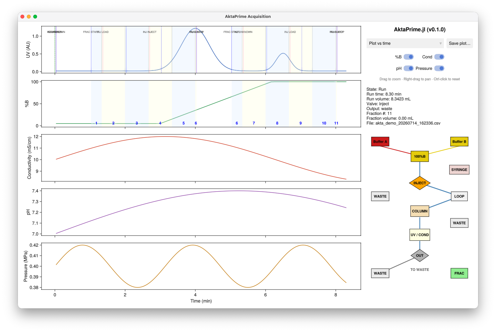

# Demo mode

You do not need an instrument to try AktaPrime.jl. If no ÄKTA Prime is found on
the serial port when the app starts, it automatically switches to **demo mode**
and feeds the display with simulated data.

This is useful for:

- learning your way around the interface before you are at the bench;
- teaching and demonstrations;
- producing example figures.



*Demo mode: a simulated run, with the gradient (%B), two UV peaks, changing
valve positions, and numbered fraction-collection spans — everything works
exactly as it does with a real instrument.*

## Starting demo mode

Just run the app on a computer with no instrument connected:

```bash
AktaPrime
```

The startup banner tells you it is running in demo mode, and reminds you how to
connect a real instrument when you are ready:

```
  No instrument was found on the serial port:
      /dev/tty.usbserial-110

  Starting in DEMO MODE with simulated data, so you can explore
  the interface without an instrument connected.
```

You are still asked for a log-file prefix, and demo data are logged to CSV
exactly as a real run would be (with a `akta_demo` default prefix), so you can
practise the whole workflow including reopening and exporting results.

## What the demo does

The demo generates a repeating chromatogram — a gradient, a couple of peaks,
changing valve positions and fraction collection — at roughly ten times real
speed. Each simulated run ends after a number of fractions and the next one
begins automatically, which also demonstrates the
[per-run file roll-over](@ref "Multiple runs"): you will see the display clear
and a fresh log file start for each new run.

Everything else — zooming, toggling panels, switching between time and volume,
and saving figures — works just as it does with a real instrument.
