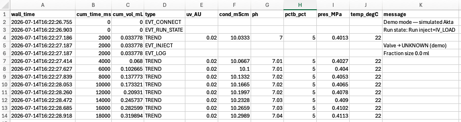

# Viewing results

You can explore a chromatogram while a run is in progress, or reopen a saved log
afterwards.

## Reopening a saved run

Click **Open run…** in the top bar and choose a CSV log. The run opens in its own
**tab** next to **Live** — recording carries on in the Live tab meanwhile. Close
a tab with its **×**.

You can also open a log directly, without connecting to the instrument:

```bash
AktaPrime lysozyme_20260714_142530.csv
```

The full display is reconstructed — traces, events, fraction spans and the run
information.

## Zooming and panning

Every chromatogram panel supports the standard interactions:

| Action | What it does |
|---|---|
| **Drag** (left mouse) | Zoom into a rectangle |
| **Right-drag** | Pan |
| **Scroll** | Zoom in/out |
| **Ctrl-click** | Reset the zoom and follow the live data again |
| **Alt- or Shift-click** | Inspect that moment (see below) |
| **Hover** | Show the values under the mouse |

The panels share a common x-axis, so zooming or panning one moves them all
together. While a run is recorded, zooming or panning switches **Follow live**
off, so your view stays put while new data arrive; tick it again (or
Ctrl-click) to follow the run.

## Choosing what to show

The toolbar above the plots:

- the **menu** sets the x-axis: **Plot vs time**, **Plot vs volume** or **Plot vs
  column volumes** (using the column volume from Run info);
- **Overlay** draws all traces in one plot, each scaled to 0–100 % of its range;
  the buttons above the plot name each trace with its real range, and clicking
  one highlights it and shows its real values on the y-axis. **Stacked** returns
  to one panel per trace;
- the **checkboxes** switch the %B, conductivity, pH, pressure and flow panels on
  and off (UV is always shown). Which ones start switched on is a
  [setting](@ref Settings);
- **Show log** opens the run log below the plots.

## Inspecting a moment

Drag the **slider** below the plots, or Alt/Shift-click in a plot, to pick a
moment: a dashed line marks it in every panel, and the Run and Readings cards and
the flow-path schematic show the state at that moment — valve positions, buffer
port, fraction, set flow and all readings. **Live** (or **End** for an opened
run) returns to the latest data.

## The run log

**Show log** lists every event of the run — valve moves, method steps, marks,
run information — with its time and volume. Type in the filter box to narrow the
list, scroll with the mouse wheel, and click a line to inspect that moment.

## Saving results as images

Click **Save plot…** to export the chromatogram — the panels currently shown, at
their current axis limits, with the overlay below them — to a **PDF** file in
the data folder (for an opened run, next to its CSV). Files are numbered per
session:

```
<prefix>_<date>_<time>_figure_1.pdf
<prefix>_<date>_<time>_figure_2.pdf
...
```

PDF is a vector format, so the figures stay crisp at any size and are ready to
drop into a report or manuscript. Exports always use the light colour scheme.

## Log file format

Each log is a plain CSV file that opens in any spreadsheet or analysis tool. A
comment line records when logging started, followed by a header row and then one
row per sample or event:

```
# Akta PRIME data log started 2026-07-14T14:25:30
wall_time,cum_time_ms,cum_vol_mL,type,uv_AU,cond_mScm,ph,pctb_pct,pres_MPa,temp_degC,message
```



*A log file opened in a spreadsheet: `TREND` rows carry the sensor values, while
event rows (`EVT_CONNECT`, `EVT_INJECT`, `EVT_LOG`, …) carry a message.*

| Column | Meaning |
|---|---|
| `wall_time` | Clock time the row was written |
| `cum_time_ms` | Cumulative run time (ms) |
| `cum_vol_mL` | Cumulative run volume (mL) |
| `type` | `TREND` for a data sample, or an event type (e.g. `EVT_INJECT`, `EVT_LOG`, `EVT_MARK` for your marks, `EVT_INFO` for run information) |
| `uv_AU` | UV absorbance (AU) |
| `cond_mScm` | Conductivity (mS/cm) |
| `ph` | pH |
| `pctb_pct` | Gradient %B |
| `pres_MPa` | Pressure (MPa) |
| `temp_degC` | Temperature (°C) |
| `message` | Text of an event row (blank for trend rows) |

Trend rows carry the sensor values; event rows carry a message and leave the
sensor columns blank.
